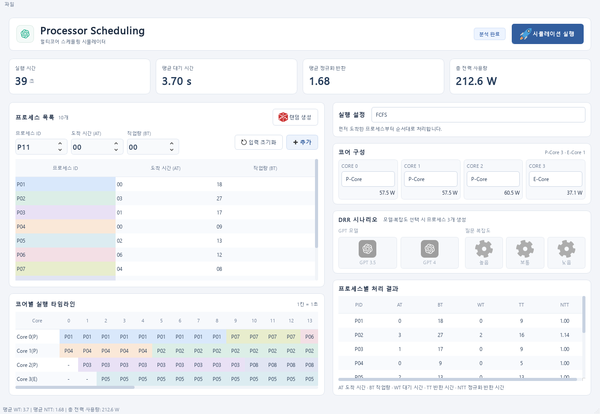
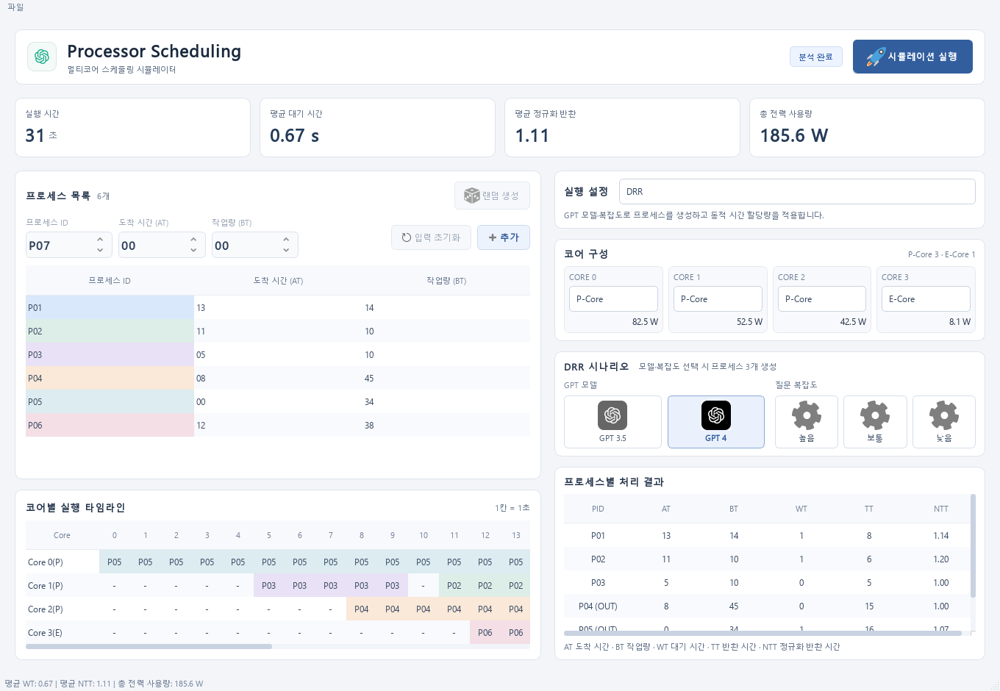

<div align="center">

# Processor Scheduling Simulator

**6가지 스케줄링 알고리즘과 P-Core·E-Core 구성을 실험하는 데스크톱 시뮬레이터**


[화면 미리보기](#화면-미리보기) · [주요 기능](#주요-기능) · [알고리즘](#스케줄링-알고리즘) · [실행 방법](#실행과-개발) · [문서](#문서)

</div>

## 화면 미리보기



<p align="center"><sub>FCFS · P-Core 3개 + E-Core 1개 · 프로세스 10개</sub></p>

코어별 실행 순서·프로세스 대기 시간·전력 모델 값을 한 화면에서 비교합니다.

## 주요 기능

| 기능 | 내용 |
| --- | --- |
| **프로세스 구성** | PID·도착 시간·작업량을 직접 입력하거나 무작위로 생성합니다. |
| **코어 설정** | 최대 4개 코어를 Off·P-Core·E-Core로 구성합니다. P-Core는 최대 3개, E-Core는 최대 1개입니다. |
| **실행 타임라인** | 코어별 프로세스 배치와 유휴 구간을 색상으로 구분합니다. |
| **결과 분석** | 프로세스별 WT·TT·NTT와 전체 실행 시간·평균 지표·코어별 전력 모델 값을 확인합니다. |
| **DRR 시나리오** | GPT 모델·질문 복잡도 프리셋으로 프로세스를 생성하고, 동적 시간 할당과 OUT 상태를 확인합니다. |

## 스케줄링 알고리즘

| 알고리즘 | 실행 방식 |
| --- | --- |
| **FCFS** · First-Come, First-Served | 먼저 도착한 프로세스부터 실행합니다. |
| **RR** · Round Robin | 설정한 시간 할당량만큼 번갈아 실행합니다. |
| **SPN** · Shortest Process Next | 대기 중인 프로세스 중 작업량이 가장 작은 것을 선택합니다. |
| **SRTN** · Shortest Remaining Time Next | 남은 작업량이 가장 작은 프로세스를 우선 배치하는 선점 방식입니다. |
| **HRRN** · Highest Response Ratio Next | 대기 시간과 작업량으로 계산한 응답 비율이 높은 프로세스를 선택합니다. |
| **DRR** · Dynamic Round Robin | 복잡도와 남은 작업량에 따라 P-Core·E-Core 배치와 시간 할당량을 조절합니다. |

## DRR 시나리오

**GPT 3.5 또는 GPT 4를 고르고 질문 복잡도를 설정하면 프로세스 3개가 생성됩니다.**



GPT 3.5·보통 복잡도와 GPT 4·높은 복잡도로 생성한 프로세스를 함께 실행한 예시입니다.

## 결과 지표

| 지표 | 의미 |
| --- | --- |
| **AT / BT** | 도착 시간 / 처리할 작업량 |
| **WT / TT** | 대기 시간 / 도착부터 종료까지의 반환 시간 |
| **NTT** | 반환 시간을 실제 실행 tick 수로 나눈 값 |
| **전력 사용량** | 코어별 처리 성능·동작·시동 비용을 반영한 누적 모델 값 |

1 tick은 1초입니다. 평균 WT·NTT는 정상 완료된 프로세스를 기준으로 계산하며, DRR에서 강제 종료된 프로세스는 `OUT`으로 표시합니다. 계산식과 상세 정책은 [시뮬레이션 모델](docs/scheduling-model.md)에 정리했습니다.

## 실행과 개발

<details>
<summary><strong>설치하고 GUI 실행하기</strong></summary>

Windows에서는 Python 3.9를 준비한 뒤 프로젝트 루트에서 실행합니다.

```powershell
py -3.9 -m venv .venv
.\.venv\Scripts\python.exe -m pip install -r requirements.txt
.\.venv\Scripts\python.exe ui.py
```

알고리즘·코어·프로세스를 설정한 뒤 **시뮬레이션 실행**을 누릅니다.

macOS·Linux 설치와 자세한 조작 방법은 [사용 안내](docs/usage.md)를 참고하세요.

</details>

<details>
<summary><strong>CLI 데모와 테스트 실행하기</strong></summary>

위 가상환경을 만든 뒤 프로젝트 루트에서 실행합니다.

```powershell
# GUI 없이 DRR 예제 실행
.\.venv\Scripts\python.exe Operating_System.py

# 엔진·GUI·리소스 경로 회귀 테스트
.\.venv\Scripts\python.exe -m unittest discover -s tests -v
```

</details>

## 프로젝트 구조

```text
processor-scheduling-simulator/
├─ ui.py                 # GUI
├─ scheduler.py          # 스케줄링·지표·전력 계산 엔진
├─ Operating_System.py   # CLI 데모
├─ algorithms/           # 알고리즘별 main(Info) 호출 모듈
├─ assets/               # Qt 화면·스타일·이미지
├─ docs/                 # 사용 안내·계산 규칙·화면·개발 기록
├─ tests/                # 엔진·GUI 회귀 테스트
└─ requirements.txt
```

## 문서

[사용 안내](docs/usage.md) · [시뮬레이션 모델](docs/scheduling-model.md) · [문서 목록](docs/README.md) · [변경 기록](CHANGELOG.md)
